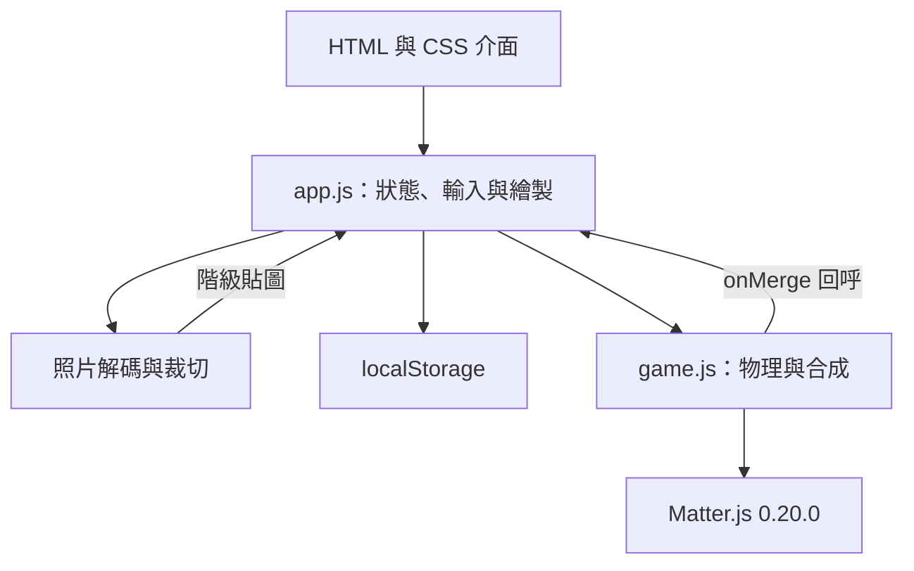
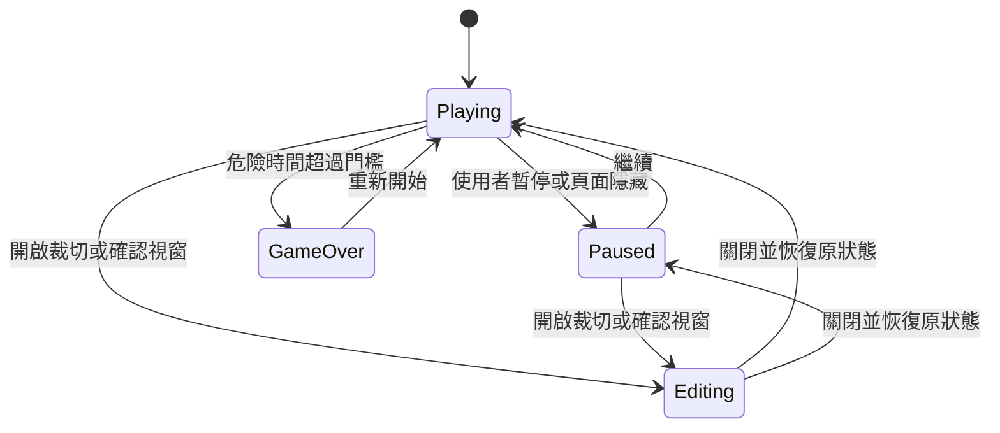

# Photo Melon｜合成我的臉：技術文件

| 項目 | 內容 |
| --- | --- |
| 文件版本 | 1.0 |
| 撰寫日期 | 2026-10-11 |
| 對應遊戲 | 圓形照片合成網頁原型，物理修正版 v3 |
| 來源版本 | `7a665924d388caa8d543e706be13114973f538ec` |
| 交付格式 | 現有原始碼、技術文件、本機啟動入口與測試 |
| 文件用途 | 在本機桌面環境繼續開發、維護或移植 |

本文件以套件內實際原始碼為準。標示「目前」的內容已存在；「建議」與「待辦」是未實作的後續工作。套件新增本機啟動入口，遊戲原始檔維持上述來源版本。

## 1. 產品範圍

遊戲把使用者選擇的照片當作球體貼圖。使用者投下小球，相同階級接觸後合成更大的球，累積分數並避免堆積超過危險線。

照片可是一張自拍分別裁切五官，也可以是不同人物、寵物或其他圖片。階級由設定決定，沒有影像相似度比對。例如第 1 與第 2 階即使使用同一張照片，也不會互相合成；第 1 階的兩顆球才會合成第 2 階。

目前提供 11 階圓形素材、手動裁切、投球與物理碰撞、分數和最高分、素材儲存、音效開關、暫停、重新開始及遊戲畫面下載。尚未實作自動辨識人臉或五官、AI 圖片生成、雲端帳號、多人模式、線上排行榜、素材分享及原生桌面安裝包。

## 2. 技術架構

### 2.1 技術選擇

| 技術 | 現有用途 | 說明 |
| --- | --- | --- |
| HTML | 頁面、工具列、素材面板、對話框 | 使用原生 `<dialog>` |
| CSS | 桌面／手機版面與視覺 | Grid、media queries；無 CSS 框架 |
| JavaScript | 遊戲與素材流程 | 原生腳本；無 React/Vue、無打包器 |
| Canvas 2D | 遊戲、縮圖、照片裁切、截圖 | 主要遊戲畫布為 440 × 610 |
| Matter.js 0.20.0 | 剛體世界、碰撞、摩擦、轉動 | 已隨原始碼包含，MIT 授權 |
| Pointer Events | 滑鼠、觸控、拖曳 | 使用 pointer capture |
| Web Audio API | 合成音效 | 使用振盪器，不載入音效檔 |
| localStorage | 最高分與自訂素材 | 來源隔離、JSON／字串儲存 |
| Node.js | 本機靜態服務、測試 | 遊戲本身在瀏覽器執行 |

應用程式沒有自訂後端 API、資料庫或模型服務。照片選取後在瀏覽器解碼，不會透過遊戲程式傳送到伺服器。本機服務只提供 `dist/` 靜態檔案。

### 2.2 模組關係



照片、存檔與畫面模組目前都位於 `app.js`，圖中是職責劃分，不代表已拆成獨立檔案。物理模組不需要 DOM，能直接由 Node.js 載入進行測試。

### 2.3 載入順序與檔案

`index.html` 依序載入 Matter.js、`game.js`、`app.js`，均使用 `defer`。`game.js` 對瀏覽器提供 `MelonPhysics` 與 `MelonRadii`；在 Node.js 中則匯出 `Physics` 與 `RADII`。

| 檔案 | 核心職責 |
| --- | --- |
| `dist/index.html` | 頁面結構、對話框、Canvas 元素、腳本順序 |
| `dist/style.css` | 主題色、版面、控制項與響應式斷點 |
| `dist/game.js` | 物理世界建立、球體新增、模擬、合成、溢出檢查與重置 |
| `dist/app.js` | 隨機階級、輸入、計分、渲染、圖片處理、存檔、音效與流程 |
| `tests/physics.cjs` | 可直接執行的物理與規則測試 |
| `start-local.cjs` | 本機開發用靜態 HTTP 服務，不是遊戲後端 |

## 3. 核心遊戲規則

### 3.1 階級與大小

程式索引由 0 開始，畫面階級由 1 開始。以下半徑以遊戲邏輯座標的像素表示。

| 畫面階級 | 程式 level | 預設素材名 | 半徑 | 直徑 | 合成到此階的加分 |
| --- | --- | --- | ---: | ---: | ---: |
| 1 | 0 | 小眼神 | 17 | 34 | — |
| 2 | 1 | 小鼻子 | 23 | 46 | 4 |
| 3 | 2 | 微笑 | 29 | 58 | 9 |
| 4 | 3 | 小表情 | 36 | 72 | 16 |
| 5 | 4 | 好奇臉 | 44 | 88 | 25 |
| 6 | 5 | 偷笑臉 | 53 | 106 | 36 |
| 7 | 6 | 開心臉 | 63 | 126 | 49 |
| 8 | 7 | 得意臉 | 74 | 148 | 64 |
| 9 | 8 | 大笑臉 | 86 | 172 | 81 |
| 10 | 9 | 超級你 | 100 | 200 | 100 |
| 11 | 10 | 完整的你 | 116 | 232 | 121 |

每次合成加分為 `(newLevel + 1)²`。第 11 階不再合成，兩顆最大球會繼續存在。首次合成到第 11 階顯示提示，不會直接結束遊戲。

新投下的球只會從第 1～4 階抽選，機率依序為 40%、30%、20%、10%。現有隨機來源是 `Math.random()`，沒有可保存的種子或重播紀錄。

### 3.2 投球、危險線與容量

| 規則 | 現有數值／行為 |
| --- | --- |
| 投球位置 | `y = 43`，x 依瞄準位置決定並限制在容器內 |
| 投球冷卻 | 0.42 秒，以物理模擬時間計算 |
| 同時球體上限 | 180 顆；達上限時拒絕新增，現有球仍能合成 |
| 危險線 | `y = 93` |
| 球體寬限 | 出生超過 1.5 秒才可能觸發危險判定 |
| 高球判定 | 球頂 `y - r < 93`，且垂直速率絕對值小於 100 px/s |
| 結束門檻 | 危險累積時間超過 1.8 秒 |
| 危險解除 | 無危險球時，以累積速度的兩倍逐步扣除危險時間 |

危險時間不是離開危險線後立刻歸零，因此反覆越線的短暫情況仍可能累積風險。合成的新球有新的出生時間，會重新取得 1.5 秒寬限。

### 3.3 遊戲狀態

目前由 `paused`、`gameOver`、`restorePause` 等變數控制，沒有獨立狀態機類別。



此圖描述行為而非精確 enum。程式在編輯視窗開啟時保留原暫停狀態；關閉後恢復。重新開始會清除球體、接觸快取、分數、粒子和危險時間，但保留素材與最高分。

## 4. 物理世界設計

### 4.1 容器與碰撞形狀

物理世界寬 440、高 610，x 向右增加、y 向下增加。容器由左右牆與地板三個靜態長方形構成，上方不封頂。左右內壁約為 x=2 與 x=438，地板碰撞表面為 y=607。

畫面上的球以 Canvas 圓形繪製；碰撞體是多邊形近似圓形，並設定 `circleRadius`。邊數依各階完成半徑計算（`SIDES`，第 1 到 11 階為 24～62 邊、一律取偶數），讓每條邊與真圓的誤差不超過約 0.15 px；小球不需要 64 邊，窄相碰撞成本因此降低。偶數邊讓 Matter.js 能合併平行的分離軸。它是剛體，沒有軟體變形、照片輪廓碰撞或物理擠壓。圓形繪製與多邊形碰撞近似之間可能存在少量像素級差異。

### 4.1.1 容器硬限制

大球質量可達最小球的四十多倍。重的堆疊壓在小球上時，Matter.js 的位置解算會讓小球陷進牆壁或地板（實測最多約 17 px，畫面上看起來被牆吃掉一半）。每個子步在 `Engine.update()` 之後執行 `_contain()`：若球超出左右內壁（x=2、x=438）或地板（y=607）超過 0.5 px，就移回容許範圍內，並把朝牆外的速度歸零。移位使用 `Body.setPosition()` 的預設模式，不會額外注入速度。

### 4.2 引擎與材質參數

| 分類 | 參數 | 現值 | 意義 |
| --- | --- | ---: | --- |
| 引擎 | `enableSleeping` | false | 靜止球繼續參與模擬，支撐消失後能下落 |
| 引擎 | `positionIterations` | 12 | 位置接觸解算次數 |
| 引擎 | `velocityIterations` | 8 | 速度接觸解算次數 |
| 引擎 | `constraintIterations` | 2 | 約束解算設定；目前無額外關節 |
| 重力 | `gravity.y` | 1 | 重力方向向下 |
| 重力 | `gravity.scale` | 0.0011 | Matter.js 重力倍率，不是直接的 px/s² 數值 |
| 球體 | `density` | 0.001 | 依面積決定質量 |
| 球體 | `friction` | 0.055 | 接觸摩擦設定 |
| 球體 | `frictionStatic` | 0.12 | Matter.js 靜摩擦設定 |
| 球體 | `frictionAir` | 0.0025 | 運動阻尼設定 |
| 球體 | `restitution` | 0.22 | 球體彈性設定 |
| 球體 | `slop` | 0.025 | 接觸解算容許量 |
| 牆體 | `friction` | 0.22 | 牆體摩擦設定 |
| 牆體 | `restitution` | 0.12 | 牆體彈性設定 |
| 牆體 | `slop` | 0.02 | 牆體接觸容許量 |

接觸效果由兩個剛體材質與 Matter.js 解算共同決定，不能把某個設定直接視為碰撞後速度保留的精確百分比。

### 4.3 關閉休眠的原因

前一個版本啟用了自動休眠。模擬已重現：上方球休眠後，將支撐球移開，上方球仍停在原位。只在合成附近喚醒球體，無法涵蓋支撐球後續滾走等情況。

目前關閉自動休眠，讓重力與接觸持續更新。這是針對可重現的支撐消失問題的修正；單張使用者截圖本身無法證明球已停止，截圖近似排列測試也不等於完整重現當時的操作歷程。

關閉休眠增加靜止堆疊的運算量。靜止接觸與多組堆疊測試已通過，但尚未完成實機效能基準，不能宣稱所有手機都能保持特定幀率。

## 5. 更新迴圈與繪製

`requestAnimationFrame()` 驅動畫面。`frame()` 計算距離上一幀的時間，單次最多採計 0.05 秒，再加入累積器。只要累積器至少有 `1/120` 秒，就前進一次物理並扣除相同時間。Matter.js 的 `Engine.update()` 接收毫秒，所以傳入 `dt × 1000`。

```javascript
// 行為摘要，不是 app.js 原文。
elapsed = Math.min(realFrameDelta, 0.05);
if (!paused && !gameOver) {
  accumulator += elapsed;
  while (accumulator >= 1 / 120) {
    physics.step(1 / 120);
    updateOverflowState();
    accumulator -= 1 / 120;
  }
}
draw();
```

`Physics.step(dt)` 本身也會把較大的 dt 拆成不超過約 `1/120` 秒的子步，避免直接使用大時間步碰撞。公開位置使用邏輯像素，速度 getter 將 Matter.js 的標準化速度乘以 60，轉成 px/s；新增球體時則除以 60。

每幀依序畫背景、危險線、瞄準線、待投球、世界球體、合成粒子與地板。照片貼圖依剛體角度旋轉，使用圓形 clip 顯示。棋盤、下一顆預覽與裁切預覽的 Canvas 依 `devicePixelRatio`（上限 3）配置實際像素，繪製仍使用原本的邏輯座標；裝置像素比改變時（例如瀏覽器縮放）會重新配置。目前沒有畫面插值或離屏背景快取。

固定時間步降低正常幀率差異對模擬的影響，但 0.05 秒的截斷代表長時間卡頓時會丟棄部分真實時間。因此「30／60／120 Hz 物理呼叫等價」的測試，不能被解讀為嚴重卡頓時也維持真實世界時間速度。

## 6. 合成演算法

### 6.1 觸發條件

每次 `Engine.update()` 後檢查 `engine.pairs.list`。可合成的接觸必須同時符合：接觸仍 active、兩者皆為照片球、仍在目前球體集合、level 相同、不是最高階、當次子步尚未用於其他合成，以及半徑已成長到目標值的容許範圍內。

`live` 集合排除已移除剛體的舊接觸；`used` 集合避免三顆接觸時同一顆被重複使用。先收集合成配對，再移除來源球與新增結果，避免在接觸掃描期間破壞集合。

### 6.2 新球狀態

新球 level 為原 level+1。位置與線速度使用來源質量加權平均：

```text
xNew = (xA × massA + xB × massB) / (massA + massB)
yNew = (yA × massA + yB × massB) / (massA + massB)
vxNew = (vxA × massA + vxB × massB) / (massA + massB)
vyNew = (vyA × massA + vyB × massB) / (massA + massB)
```

這保留了來源移動方向，但新球大小／質量會依新半徑重新建立並持續改變，並不是完整物理守恆模型。角速度採 `(angularVelocityA + angularVelocityB) × 0.25` 作為遊戲手感設定，也不是角動量守恆計算。

### 6.3 成長與連鎖合成

新球從原球半徑開始，在 0.14 秒內成長到下一階半徑：

```text
t = clamp((physicsTime - bornTime) / 0.14, 0, 1)
ease = t² × (3 - 2t)
radius = startRadius + (targetRadius - startRadius) × ease
```

每個子步用 `Body.scale()` 同時調整實際碰撞體，再更新 b.r。這不是只有視覺放大。成長中的球暫不再合成；成長完成後，持續接觸的同階球仍能觸發連鎖。成功合成以 `onMerge(newBall)` 回呼通知 `app.js` 計分、更新最高分、播放音效並生成粒子。

## 7. 球體資料與公開介面

| 欄位 | 型態／用途 |
| --- | --- |
| `id` | 遊戲層流水號；不等於 Matter body.id |
| `level` | 0～10 的整數 |
| `r` | 目前實際半徑，成長時改變 |
| `targetRadius` | 該階級的完成半徑 |
| `startRadius` | 成長起點半徑 |
| `born` | 出生時的物理時間，秒 |
| `body` | Matter.js 剛體 |
| `x`、`y` | 只讀 getter，取自 body.position |
| `vx`、`vy` | 只讀 getter，單位 px/s |
| `angle` | 只讀 getter，弧度 |
| `spin` | 只讀 getter，角速度轉成弧度／秒 |

剛體透過 `body.plugin.photo` 指回遊戲資料；此關係含循環參照，不能直接 `JSON.stringify(physics.balls)` 存檔。若要保存局面，應建立僅包含數值的資料快照，並在還原時重新建立剛體。

| `Physics` 方法 | 說明 |
| --- | --- |
| `new Physics(onMerge)` | 建立引擎與三個靜態牆體 |
| `add(level, x, y, vx, vy, initialRadius)` | 新增球；預設速度為零、初始半徑為該階半徑 |
| `step(dt)` | 前進 dt 秒；無效或非正數 dt 不執行 |
| `overflow()` | 回傳是否存在符合寬限、線位與速率條件的高球 |
| `reset()` | 清空動態剛體與接觸快取，重新加入牆體、重設時間 |

`add()` 現有驗證以 level 為主。若未來接受外部 JSON 或重播資料，還需要對位置、速度、半徑與 dt 設上限及數值驗證。

## 8. 照片處理與裁切

### 8.1 來源照片流程

使用者選擇照片後，`loadFile()` 先檢查檔案不超過 `15 × 1024 × 1024` bytes，以及 MIME 為 JPEG、PNG 或 WEBP。這是前端檢查；真正是否能解碼仍由瀏覽器 Image 決定。

以 `URL.createObjectURL(file)` 建立暫時來源，解碼後縮小到最長邊不超過 1200 像素。縮小比例是 `min(1, 1200 / max(width, height))`，不放大小圖。不透明的照片輸出品質參數 0.86 的 JPEG Data URL；PNG／WEBP 若含透明像素則改存品質 0.9 的 WEBP（瀏覽器不支援 WEBP 編碼時會退回 PNG），以保留透明度。再解碼為裁切來源；最後釋放暫時 Object URL。

JPEG 品質參數是傳給瀏覽器編碼器的設定，不是固定檔案大小保證。透明區域在產生貼圖時以該階的底色填滿。尚未進行 HEIC 支援、超大解碼像素防護或可靠的 EXIF 方向跨瀏覽器測試。

`loadTicket` 用於排除已過期的非同步照片結果，也避免較慢的素材還原蓋掉較新的操作；它不等於完整取消機制，已開始的解碼仍可能使用記憶體。

### 8.2 裁切座標

裁切預覽為 400 × 400 Canvas，中間可視圓半徑 160，對應 320 × 320 的選區。裁切狀態是來源圖座標的中心 `cx`、`cy`，以及 `zoom`。`zoom` 下限是「短邊 ÷ 長邊」，此時整張照片都能放進圓內；上限為 5 倍。可用滑桿、滑鼠滾輪、雙指捏合或 `+`／`-` 鍵縮放，拖曳或方向鍵移動照片。

```text
side = min(imageWidth, imageHeight) / zoom
sx = cx - side / 2
sy = cy - side / 2
```

選區小於照片的方向，中心會限制在來源圖可用範圍；選區大於照片的方向則置中，空白處以該階底色填滿（裁切預覽同樣顯示底色）。拖曳距離需先依 CSS 顯示尺寸換算回來源圖座標。確認時把正方形選區繪製成 512 × 512 的 Canvas 貼圖（`TILE`），圓形遮罩是在顯示時套用。

第一次主上傳會將同一個圈選套用到全部 11 階，每階各自以自己的底色產生貼圖。各階後續可獨立重新裁切或更換照片。現有程式沒有自動把一張臉分成眼睛、鼻子、嘴巴，也不會比較兩張圖片是否相同。

## 9. 本機資料儲存

### 9.1 儲存項目

| localStorage key | 格式 | 時機 |
| --- | --- | --- |
| `photo-melon-best` | 數字字串 | 每次合成後若超越最高分即嘗試寫入 |
| `photo-melon-theme` | JSON，version=2（仍可讀取 version=1） | 使用者按「儲存我的素材」才寫入 |

目前不儲存進行中的球體、分數、隨機狀態或音效偏好。重開頁面會開始新局；修改素材但未按儲存，重開後不會保留修改。更換素材會直接更新目前世界中該階球的外觀，物理剛體仍保持原本階級。

### 9.2 素材 JSON 結構

以下是格式示意；Data URL 已用文字代稱，不能直接當作可用照片匯入。

```json
{
  "version": 2,
  "urls": ["<縮小後來源照片的 JPEG 或 WEBP Data URL>"],
  "levels": [
    {
      "source": 0,
      "crop": { "cx": 400, "cy": 400, "zoom": 2 }
    },
    null, null, null, null, null, null, null, null, null, null
  ]
}
```

`urls` 對相同來源 Data URL 去重，`source` 指向其索引；`levels` 固定 11 格，null 代表預設素材。貼圖不另外儲存，還原時由來源照片與 `crop` 重新產生；version=1 存檔中的 `output` 欄位會被忽略。來源無法解碼或 `crop` 數值無效的階段改用預設表情並提示。來源照片會一起保存，以便重新裁切，因此保存的不只是可見的五官片段。

### 9.3 隱私、容量與錯誤

照片不由遊戲送往後端，但瀏覽器儲存不是加密保險箱，同來源的程式碼可存取這些資料。恢復預設會清除已儲存素材，不會清除最高分。

儲存配額與隱私模式行為由瀏覽器決定。素材寫入失敗會顯示訊息且保留當前記憶體素材；最高分寫入失敗目前靜默處理，畫面仍顯示最高分但下次可能無法保留。損壞的素材 JSON／解碼錯誤會回退預設並顯示訊息；還原格式驗證仍較基本。

HTTP origin 包含協定、主機名稱與連接埠。線上版與本機版、`localhost` 與 `127.0.0.1`、8000 與 8001 的存檔不共用。當前沒有匯出／匯入或雲端同步功能。

## 10. 輸入、版面與媒體

| 功能 | 現有行為 |
| --- | --- |
| 滑鼠／觸控 | 按下後可拖曳瞄準，放開投下；取消事件不投球 |
| 鍵盤 | 遊戲 Canvas 聚焦後，左右方向鍵瞄準（限制在 0～440）、空白鍵投球、P 暫停；裁切 Canvas 聚焦後，方向鍵移動照片、`+`／`-` 縮放 |
| 位置換算 | `(clientX - canvasLeft) × 440 / displayedWidth` |
| 暫停 | 使用者按鈕、頁面隱藏、編輯／確認對話框 |
| 音效 | 初始關閉；以 Web Audio 正弦波產生約 0.2 秒合成聲 |
| 截圖 | 輸出 440 × 680 邏輯尺寸、依裝置像素比放大的 PNG，包含標題、分數與棋盤 |
| 響應式 | 主要斷點 1100、780、390 px；小螢幕素材區移到棋盤下方 |
| 無障礙 | 控制項 aria-label、分數／合成提示 aria-live、可見鍵盤焦點 |

目前棋盤仍主要依賴視覺，並未提供完整的非視覺遊戲替代操作。原生 dialog、Pointer Events、圖片解碼、音效和下載行為仍需跨瀏覽器實測。

## 11. 本機執行與交付

本機可直接服務 `dist/`，沒有安裝依賴或 build 步驟。套件提供 `node start-local.cjs` 與 Windows 批次入口，預設只監聽 `127.0.0.1:8000`，不開放區域網路存取。它處理 GET／HEAD、Content-Type、404、無效 URL 與明顯路徑越界，並關閉快取，方便刷新開發結果。

瀏覽器遊戲依賴均包含在 dist，可在啟動本機服務後不依賴外部 CDN 遊玩。這不代表已提供 PWA 安裝、Service Worker 離線更新或打包好的 EXE。

若要部署網頁，將完整 dist 放到靜態託管服務並以根目錄 index.html 為入口。這份交付不含線上專案的部署身分與憑證；後續部署使用自己的設定即可。

若要改成獨立桌面應用，建議先保留 HTML/Canvas 與 game.js 的邊界，另行決定外層包裝。若移植到 Godot，則必須重新串接引擎的剛體與訊號；Matter.js 程式不能直接當作 GDScript 使用。兩種路線目前皆未實作。

## 12. 測試與驗收

### 12.1 現有自動測試

指令：`node --test tests/physics.cjs`。目前 13 項測試全部通過，測試程式隨套件附上。

| 編號 | 覆蓋行為 |
| --- | --- |
| 1 | 自由落下、明顯反彈、落地穩定且不強制休眠 |
| 2 | 小球從大球側面滾落，並產生角速度 |
| 3 | 靜止上方球在支撐移開後繼續落下 |
| 4 | 使用者截圖的近似球體排列能讓紫球落到地面 |
| 5 | 側牆反彈，球不逃出容器 |
| 6 | 同階合成一次、短暫成長並保留移動方向 |
| 7 | 三顆同階接觸時不重複使用來源球 |
| 8 | 連鎖合成與最高階維持分離 |
| 9 | 新球寬限與高位球危險判定 |
| 10 | 重置清除舊剛體與接觸快取 |
| 11 | 30／60／120 Hz 呼叫以相同子步得到相同結果 |
| 12 | 8 組固定種子堆疊：有限數值、無逃逸、低整體運動量及小於 0.6 px 的球間重疊 |
| 13 | 3 組固定種子的實際投球與合成流程：任何子步都沒有球陷入牆壁或地板超過 0.6 px |

來源開發過程另做過以替身 DOM 搭配 Canvas 的程式檢查，涵蓋初始化、暫停、重置、裁切、素材去重與保存。該檢查不是實際瀏覽器測試，亦未作為獨立可攜測試加入本套件。

### 12.2 桌面與手機手動驗收清單

| 情境 | 驗收重點 | 狀態 |
| --- | --- | --- |
| 大圖、直圖、橫圖與透明圖片 | 解碼、縮圖、方向與背景符合預期 | 待完整實測 |
| 每階使用不同照片 | 階級判定仍正確，換圖不改變物理狀態 | 待實際瀏覽器驗收 |
| 資料保存與重開 | 素材、最高分、配額失敗提示 | 程式檢查已有，實機待驗 |
| 拖出棋盤再放開／觸控取消 | 不重複投球、不留下卡住的 pointer | 待跨裝置實測 |
| 編輯前已暫停 | 關閉對話框後仍維持暫停 | 程式檢查已有，實機待驗 |
| 手機低效能與大量球體 | 幀時間、輸入延遲、貼圖記憶體與卡頓恢復 | 未完成基準 |
| 截圖下載與 Web Audio | 使用者手勢、下載目的地、音效啟動 | 待跨瀏覽器實測 |

## 13. 開發修改指南

### 13.1 可優先調整的參數

手感調整先從重力、球體 restitution、friction／frictionStatic 與 frictionAir 開始，每次只改一組目標，並比較掉落時間、落地反彈高度、側向滾動、合成擠壓和靜止堆疊。調整 solver 次數通常影響穩定性與效能，不能直接當成讓球更彈的手段。

一般情況維持固定物理時間步。若更改 restitution、摩擦、成長時間或幾何邊數，先跑現有測試，再做實際遊玩；模擬通過不等於主觀手感完成。

### 13.2 需要同步修改的項目

| 變更 | 需要同步檢查 |
| --- | --- |
| 階級數 | RADII、colors、names、來源陣列長度、素材 JSON 驗證、HTML「11 階」文案、最高階提示、測試 |
| 棋盤尺寸 | Canvas width/height、物理世界、牆體、x 限制、瞄準換算、繪製固定值、地板、截圖輸出 |
| 危險線 | `Physics.overflow()` 的 93 與 app.js 線位／提示位置 |
| 投球間隔 | drop() 的 0.42 與預覽透明度使用的相同常數 |
| 貼圖解析度 | `TILE`（512）的輸出與預設素材大小、記憶體、繪製品質 |
| 保存格式 | version、儲存與還原、舊資料遷移策略 |
| 新增局面存檔 | 純數值快照、剛體重建、born／成長進度、隨機狀態與分數 |

### 13.3 建議後續工作（未實作）

| 優先序 | 工作 | 目的 |
| --- | --- | --- |
| P0 | 真實瀏覽器操作與手機效能基準 | 驗證目前最大缺口 |
| P0 | 集中階級、畫布、危險線與冷卻設定 | 避免跨檔案固定值不同步 |
| P1 | 拆分素材、儲存、繪製、輸入與遊戲狀態模組 | 改善單檔密集程式碼的維護性 |
| P1 | 素材匯出／匯入與資料結構驗證 | 支援線上版與本機版搬移 |
| P1 | 圖片解碼像素上限與錯誤情境測試 | 減少超大來源圖的記憶體風險 |
| P1 | 以 IndexedDB + Blob 取代大量 Data URL | 降低同步儲存阻塞並改善素材容量 |
| P2 | 背景快取、必要時效能降級 | 改善較弱裝置表現 |
| P2 | 種子化隨機與局面快照 | 支援問題重現與重播 |
| P2 | 可選的自動人臉／五官定位 | 降低第一次手動裁切成本 |
| P2 | 桌面應用外層或 Godot 移植 | 依產品平台需求另立工作範圍 |

## 14. 現況結論

現有專案可直接在本機瀏覽器執行，也可作為後續桌面開發的基礎。核心互動、照片素材、圓形物理合成與可重現的懸空修正已存在；剩餘工作主要是實機驗證、參數集中、模組整理與跨環境素材搬移。第三方 Matter.js 檔案及其 MIT 授權已包含，擴充時應保留授權文件。
